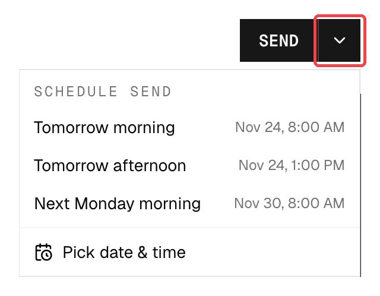
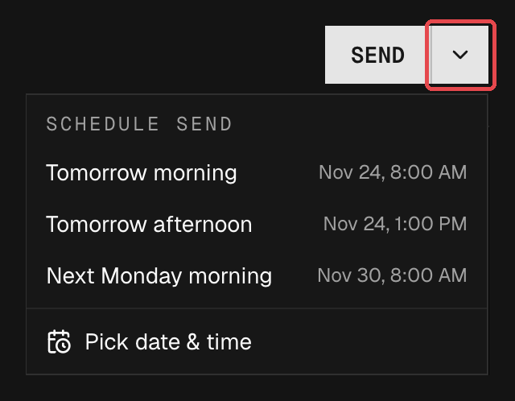
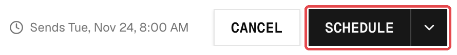
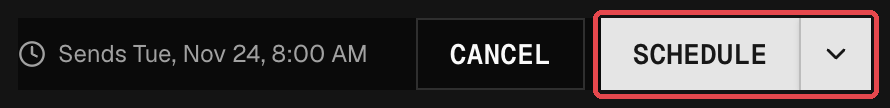
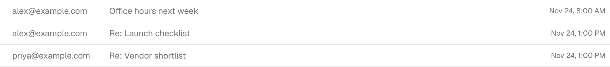
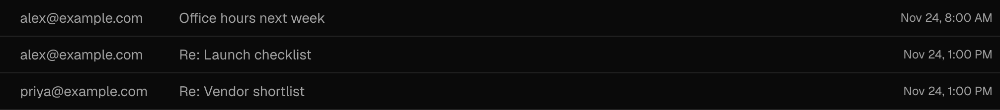
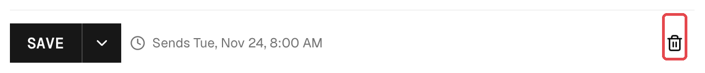
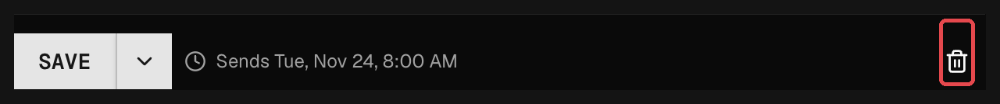

Open an inbox and click the arrow next to **Send**. Pick a time, then click **Schedule**. The email waits in **Scheduled** until then.

The time has to be at least 30 seconds from now and within 30 days. Rate limits, recipient policy, and content checks run when it goes out, not when you schedule it.

## Pick a time

<Steps>
  <Step title="Open the menu">
    The arrow next to **Send** opens the menu. It lists the next morning, the next afternoon, and the next Monday morning. **Pick date & time** is for any other time.

    <Frame>
      
      
    </Frame>
  </Step>
  <Step title="Schedule it">
    After you pick a time, the button changes from **Send** to **Schedule**, and a line next to it shows when it will go. Click **Schedule**. **Send now** in the same menu clears the time.

    <Frame>
      
      
    </Frame>

    A toast confirms the time. **View** opens that email. **Undo** puts it back in **Drafts**.
  </Step>
</Steps>

## Change it

**Scheduled**, in the inbox sidebar, lists what is still waiting, soonest first.

<Frame>
  
  
</Frame>

Open a row to edit the message or pick a new time, then click **Save**. The line next to **Save** shows when it sends. **Send now** is in the arrow menu. Choose it, then click **Send now**.

The trash icon is **Cancel send**. It stops the email and moves it back to **Drafts**. Closing the window leaves it scheduled.

<Frame>
  
  
</Frame>

A reply stays in its thread, marked **Scheduled**, and opens the same editor.

## If it fails

A send that cannot go out stays in **Scheduled**, marked **Failed**, with the reason next to the subject. It was never sent. **Dismiss** removes it from the list.

## From the API or the CLI

Pass `sendAt` when you [send an email](/api-reference/messages/send-email). The response is `202` with `status: scheduled`. [Sending a draft](/api-reference/drafts/send-email-draft) takes the same field, and the draft leaves Drafts.

`GET /v1/inboxes/{id}/scheduled-sends` lists what is waiting. `PATCH` on a send changes `sendAt` only. `DELETE` cancels it and does not put the email back in Drafts.

```bash
openmail send --to recipient@example.com --subject "Thursday" \
  --body "Thursday works." --send-at 2026-11-24T06:00:00Z
openmail scheduled list
```

To schedule a saved draft from CLI 0.13.0 or OpenClaw plugin 0.1.12, read the draft and use its exact `updatedAt`:

```bash
openmail drafts send --draft-id "<draft-id>" --updated-at "<reviewed updatedAt>" --send-at "<ISO-8601 time with timezone>" --json
```

In OpenClaw, prefix the command with `openclaw openmail --` in place of `openmail`. In hosted MCP, call `send_draft`. In Hermes 0.3.5, call `openmail_send_draft`. Both take `draft_id`, the reviewed `updated_at`, and the requested time in `send_at`. When the draft is accepted, it leaves Drafts. Keep the scheduled-send ID to change the time or cancel it.

To schedule a new message or a reply, pass `send_at` to hosted MCP’s `send_email` or `reply_to_thread`, or to Hermes 0.4.0’s `openmail_send` or `openmail_reply`. In MCP, use `list_scheduled_sends` to find a send, then pass its `send_id` to `reschedule_scheduled_send` with a new `send_at`, or to `cancel_scheduled_send`. The equivalent Hermes tools use the `openmail_` prefix.

The other commands are on the [CLI](/integrations/cli#scheduled) page.
